# The app, driven in a real browser

HeadlessChrome/153.0.8010.0 against `http://localhost:4200` in demo mode (`?demo=1`).
29 steps. Generated by `tools/e2e-drive.mjs`; screenshots are in `docs/e2e/`.

## Steps

### 01-onboarding-welcome

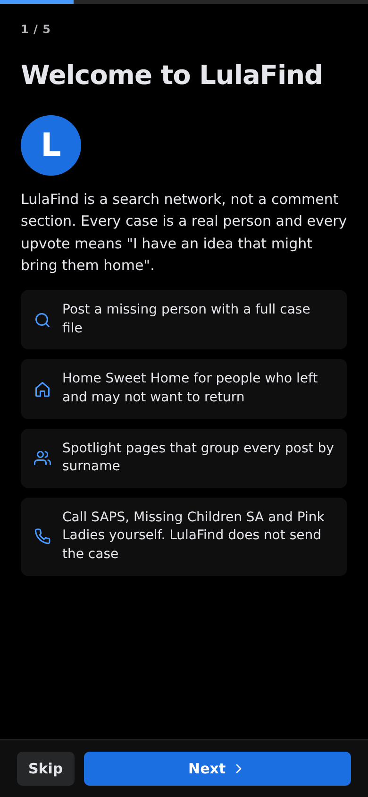

```text
Demo data - sample cases, not real people. Turn it off in the URL with ?demo=0
1 / 5
Welcome to LulaFind
L
LulaFind is a search network, not a comment section. Every case is a real person and every upvote means "I have an idea that might bring them home".
Post a missing person with a full case file
Home Sweet Home for people who left and may not want to return
Spotlight pages that group every post by surname
Call SAPS, Missing Children SA and Pink Ladies yourself. LulaFind does not send the case
Skip
Next
```

### 02-onboarding-done - /home


```text
Demo data - sample cases, not real people. Turn it off in the URL with ?demo=0
Search
1
5
All
Missing people
4
Home Sweet Home
Sightings
Lost pets
Most recent
Still missing
Reset
Lerato Mahlangu commented on this
Thandi Mokoena
Community organiser. If you see something, say something. Ubuntu.
3d
·
Gauteng
·
Missing person
Help find Thato Mokoena, 14 - last seen Orlando West, Soweto
Last seen: Orlando taxi rank, Soweto
Thato left home on Tuesday morning for school at Orlando High and never arrived. She was wearing her full school uniform with a grey cardigan and black takkies.
Her phone went off at 09:40 near the Orlando taxi rank. She was with her cousin Nokuthula, who says Thato said she wa
```

### 03-feed-signed-in - LulaFind

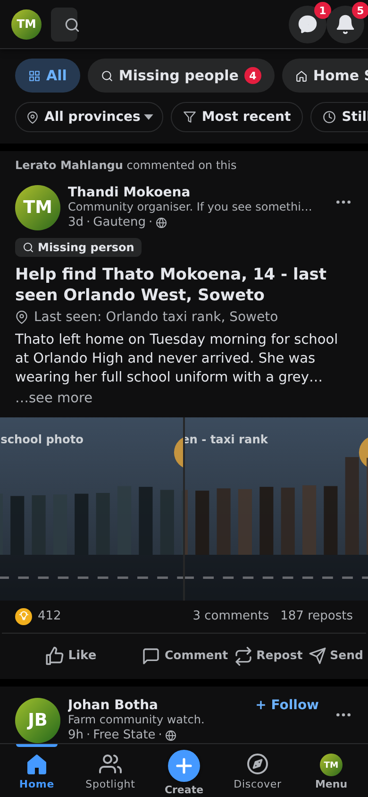

```text
Demo data - sample cases, not real people. Turn it off in the URL with ?demo=0
Search
1
5
All
Missing people
4
Home Sweet Home
Sightings
Lost pets
Most recent
Still missing
Reset
Lerato Mahlangu commented on this
Thandi Mokoena
Community organiser. If you see something, say something. Ubuntu.
3d
·
Gauteng
·
Missing person
Help find Thato Mokoena, 14 - last seen Orlando West, Soweto
Last seen: Orlando taxi rank, Soweto
Thato left home on Tuesday morning for school at Orlando High and never arrived. She was wearing her full school uniform with a grey cardigan and black takkies.
Her phone went off at 09:40 near the Orlando taxi rank. She was with her cousin Nokuthula, who says Thato said she wa
```

### 04-case-opened - /post/p_thato?demo=1

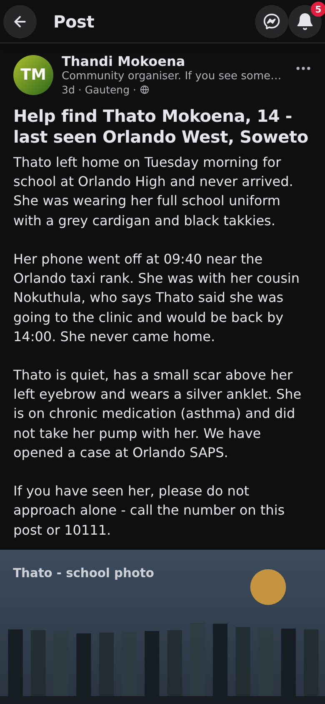

```text
Demo data - sample cases, not real people. Turn it off in the URL with ?demo=0
Post
5
Thandi Mokoena
Community organiser. If you see something, say something. Ubuntu.
3d · Gauteng ·
Help find Thato Mokoena, 14 - last seen Orlando West, Soweto
Thato left home on Tuesday morning for school at Orlando High and never arrived. She was wearing her full school uniform with a grey cardigan and black takkies.
Her phone went off at 09:40 near the Orlando taxi rank. She was with her cousin Nokuthula, who says Thato said she was going to the clinic and would be back by 14:00. She never came home.
Thato is quiet, has a small scar above her left eyebrow and wears a silver anklet. She is on chronic medicat
```

### 05-reaction-tray-open - held: the tray is open

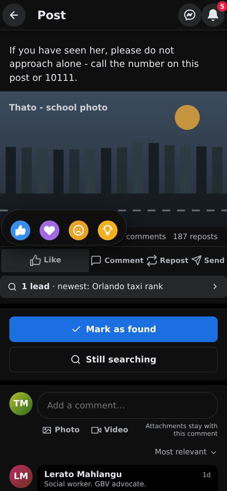

```text
Demo data - sample cases, not real people. Turn it off in the URL with ?demo=0
Post
5
Thandi Mokoena
Community organiser. If you see something, say something. Ubuntu.
3d · Gauteng ·
Help find Thato Mokoena, 14 - last seen Orlando West, Soweto
Thato left home on Tuesday morning for school at Orlando High and never arrived. She was wearing her full school uniform with a grey cardigan and black takkies.
Her phone went off at 09:40 near the Orlando taxi rank. She was with her cousin Nokuthula, who says Thato said she was going to the clinic and would be back by 14:00. She never came home.
Thato is quiet, has a small scar above her left eyebrow and wears a silver anklet. She is on chronic medicat
```

### 06-reacted - after sliding onto Like and letting go

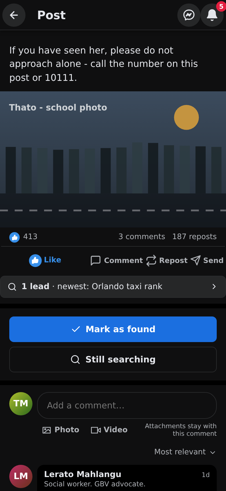

```text
Demo data - sample cases, not real people. Turn it off in the URL with ?demo=0
Post
5
Thandi Mokoena
Community organiser. If you see something, say something. Ubuntu.
3d · Gauteng ·
Help find Thato Mokoena, 14 - last seen Orlando West, Soweto
Thato left home on Tuesday morning for school at Orlando High and never arrived. She was wearing her full school uniform with a grey cardigan and black takkies.
Her phone went off at 09:40 near the Orlando taxi rank. She was with her cousin Nokuthula, who says Thato said she was going to the clinic and would be back by 14:00. She never came home.
Thato is quiet, has a small scar above her left eyebrow and wears a silver anklet. She is on chronic medicat
```

### 07-comment-typed

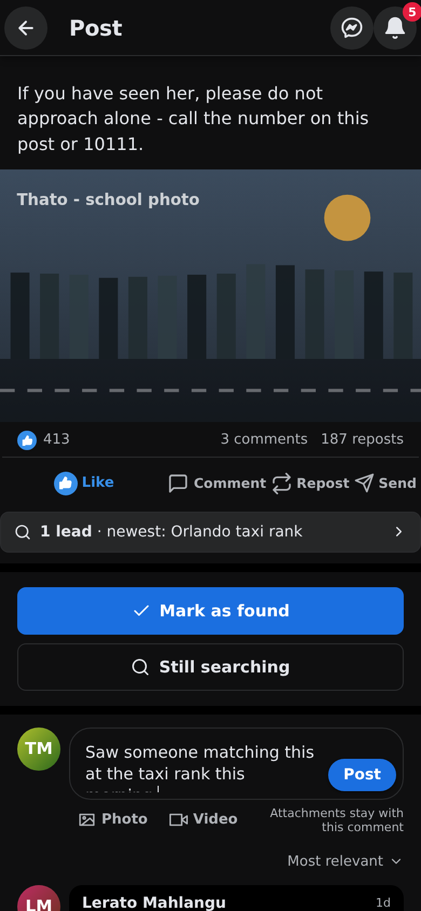

```text
Demo data - sample cases, not real people. Turn it off in the URL with ?demo=0
Post
5
Thandi Mokoena
Community organiser. If you see something, say something. Ubuntu.
3d · Gauteng ·
Help find Thato Mokoena, 14 - last seen Orlando West, Soweto
Thato left home on Tuesday morning for school at Orlando High and never arrived. She was wearing her full school uniform with a grey cardigan and black takkies.
Her phone went off at 09:40 near the Orlando taxi rank. She was with her cousin Nokuthula, who says Thato said she was going to the clinic and would be back by 14:00. She never came home.
Thato is quiet, has a small scar above her left eyebrow and wears a silver anklet. She is on chronic medicat
```

### 08-comment-posted

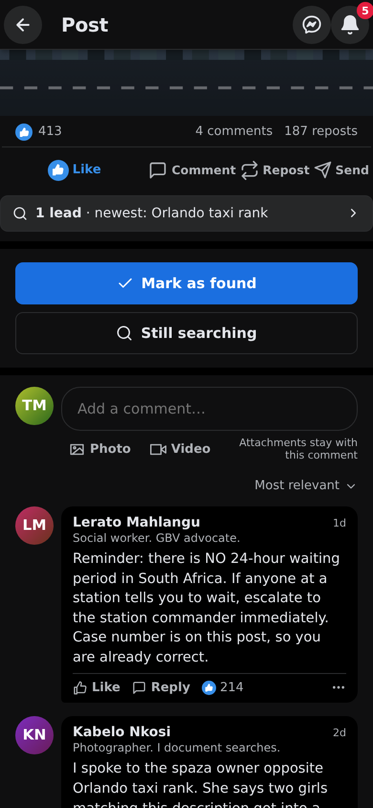

```text
Demo data - sample cases, not real people. Turn it off in the URL with ?demo=0
Post
5
Thandi Mokoena
Community organiser. If you see something, say something. Ubuntu.
3d · Gauteng ·
Help find Thato Mokoena, 14 - last seen Orlando West, Soweto
Thato left home on Tuesday morning for school at Orlando High and never arrived. She was wearing her full school uniform with a grey cardigan and black takkies.
Her phone went off at 09:40 near the Orlando taxi rank. She was with her cousin Nokuthula, who says Thato said she was going to the clinic and would be back by 14:00. She never came home.
Thato is quiet, has a small scar above her left eyebrow and wears a silver anklet. She is on chronic medicat
```

### 09-checklist-open


```text
Demo data - sample cases, not real people. Turn it off in the URL with ?demo=0
Post
5
Thandi Mokoena
Community organiser. If you see something, say something. Ubuntu.
3d · Gauteng ·
Help find Thato Mokoena, 14 - last seen Orlando West, Soweto
Thato left home on Tuesday morning for school at Orlando High and never arrived. She was wearing her full school uniform with a grey cardigan and black takkies.
Her phone went off at 09:40 near the Orlando taxi rank. She was with her cousin Nokuthula, who says Thato said she was going to the clinic and would be back by 14:00. She never came home.
Thato is quiet, has a small scar above her left eyebrow and wears a silver anklet. She is on chronic medicat
```

### 10-checklist-ticked - the count should have moved

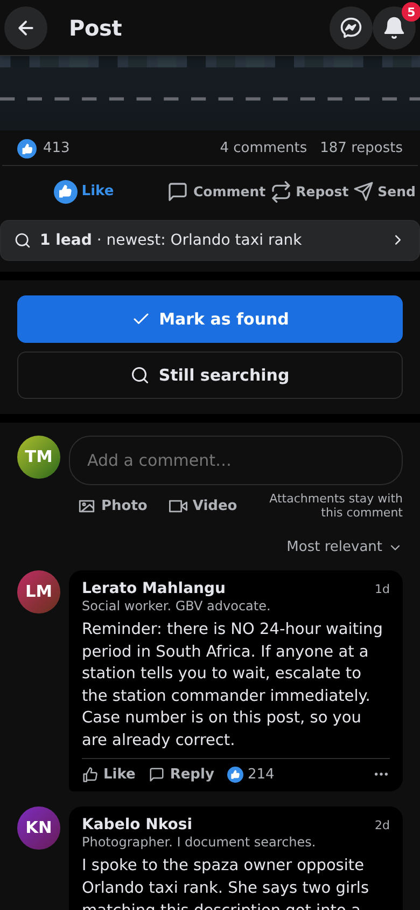

```text
Demo data - sample cases, not real people. Turn it off in the URL with ?demo=0
Post
5
Thandi Mokoena
Community organiser. If you see something, say something. Ubuntu.
3d · Gauteng ·
Help find Thato Mokoena, 14 - last seen Orlando West, Soweto
Thato left home on Tuesday morning for school at Orlando High and never arrived. She was wearing her full school uniform with a grey cardigan and black takkies.
Her phone went off at 09:40 near the Orlando taxi rank. She was with her cousin Nokuthula, who says Thato said she was going to the clinic and would be back by 14:00. She never came home.
Thato is quiet, has a small scar above her left eyebrow and wears a silver anklet. She is on chronic medicat
```

### 11-poster - the route the composer opens after publishing

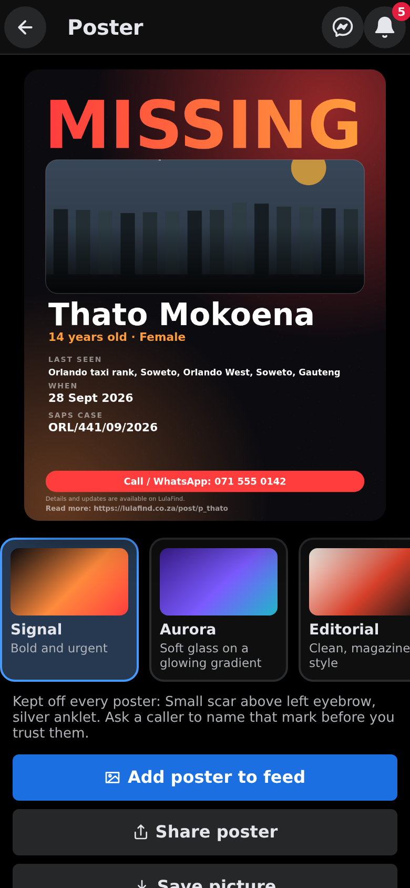

```text
Demo data - sample cases, not real people. Turn it off in the URL with ?demo=0
Poster
5
Signal
Bold and urgent
Aurora
Soft glass on a glowing gradient
Editorial
Clean, magazine style
Beacon
High-visibility yellow
Ubuntu
Proudly South African
Noir
Full-bleed photo, cinematic
Halo
AI-gradient glass card
Pulse
Neon grid, glowing type
Kept off every poster: Small scar above left eyebrow, silver anklet. Ask a caller to name that mark before you trust them.
Add poster to feed
Share poster
Save picture
Official SAPS missing list
Back to post
```

### 12-poster-second-template - Ubuntu template, freshly drawn

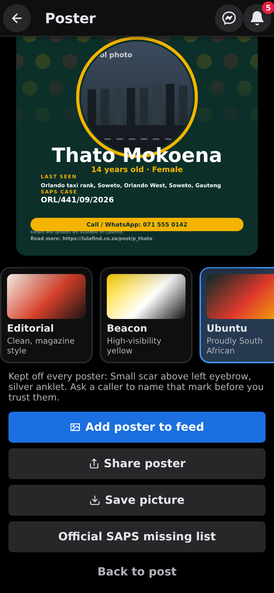

```text
Demo data - sample cases, not real people. Turn it off in the URL with ?demo=0
Poster
5
Signal
Bold and urgent
Aurora
Soft glass on a glowing gradient
Editorial
Clean, magazine style
Beacon
High-visibility yellow
Ubuntu
Proudly South African
Noir
Full-bleed photo, cinematic
Halo
AI-gradient glass card
Pulse
Neon grid, glowing type
Kept off every poster: Small scar above left eyebrow, silver anklet. Ask a caller to name that mark before you trust them.
Add poster to feed
Share poster
Save picture
Official SAPS missing list
Back to post
```

### 13-new-post


```text
Demo data - sample cases, not real people. Turn it off in the URL with ?demo=0
Create post
Post
Thandi Mokoena
Public
Followers
Spotlight
What are you posting?
Choose one
Missing person
Home Sweet Home
Lost pet
Sighting
Choose a category to start your post.
Share only information you are allowed to post. In an emergency, call 10111.
```

### 13b-new-post-missing

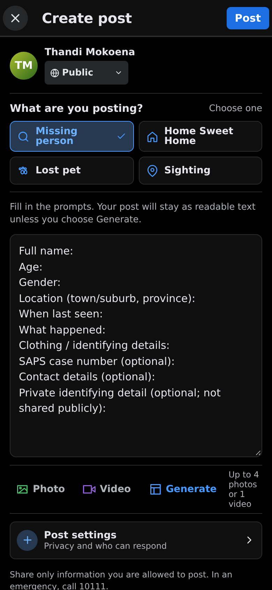

```text
Demo data - sample cases, not real people. Turn it off in the URL with ?demo=0
Create post
Post
Thandi Mokoena
Public
Followers
Spotlight
What are you posting?
Choose one
Missing person
Home Sweet Home
Lost pet
Sighting
Fill in the prompts. Your post will stay as readable text unless you choose Generate.
Photo
Video
Generate
Up to 4 photos or 1 video
Post settings
Privacy and who can respond
Share only information you are allowed to post. In an emergency, call 10111.
```

### 14-new-post-filled

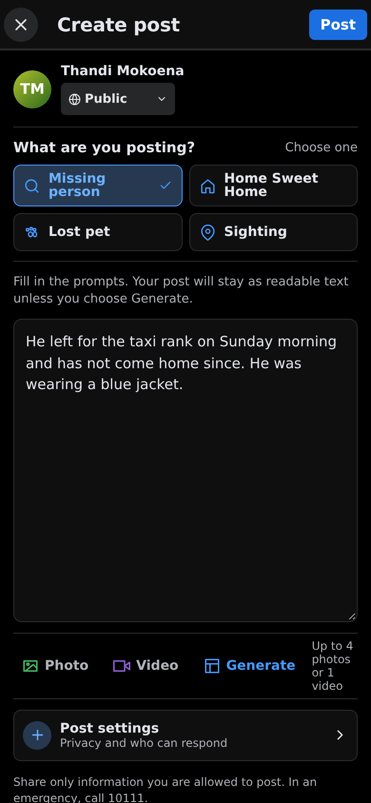

```text
Demo data - sample cases, not real people. Turn it off in the URL with ?demo=0
Create post
Post
Thandi Mokoena
Public
Followers
Spotlight
What are you posting?
Choose one
Missing person
Home Sweet Home
Lost pet
Sighting
Fill in the prompts. Your post will stay as readable text unless you choose Generate.
Photo
Video
Generate
Up to 4 photos or 1 video
Post settings
Privacy and who can respond
Share only information you are allowed to post. In an emergency, call 10111.
```

### 13-tab-spotlight - Spotlight

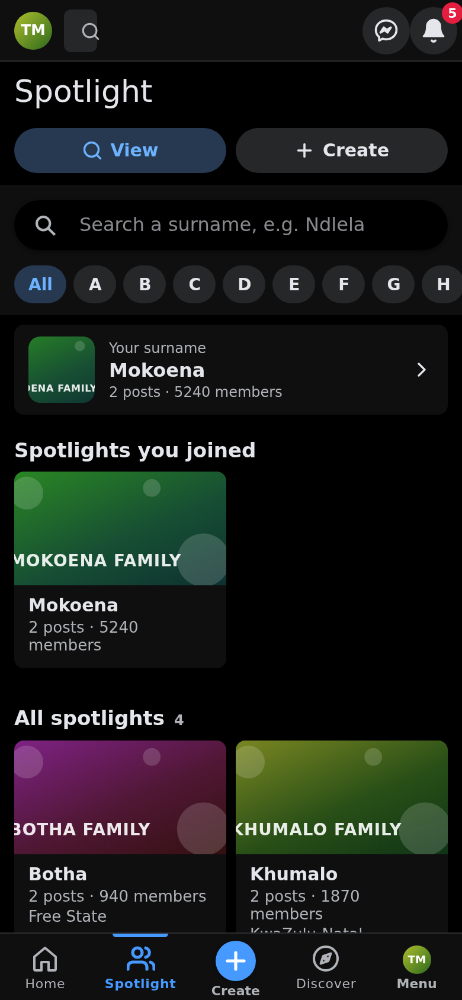

```text
Demo data - sample cases, not real people. Turn it off in the URL with ?demo=0
Search
5
Spotlight
View
Create
All
A
B
C
D
E
F
G
H
I
J
K
L
M
N
O
P
Q
R
S
T
U
V
W
X
Y
Z
Your surname
Mokoena
2 posts · 5240 members
Spotlights you joined
Mokoena
2 posts · 5240 members
All spotlights
4
Botha
2 posts · 940 members
Free State
Khumalo
2 posts · 1870 members
KwaZulu-Natal
Mokoena
2 posts · 5240 members
Gauteng
Joined
Ndlela
3 posts · 3120 members
KwaZulu-Natal
Verified
Home
Spotlight
Create
Discover
Menu
```

### 13-tab-chats - Chats


```text
Demo data - sample cases, not real people. Turn it off in the URL with ?demo=0
Chats
1
5
You can message someone once you follow each other.
Kabelo Nkosi
1h
Yes - and the school photo, not the taxi rank one. She remembers faces,
1
Help find Thato Mokoena, 14 - last
Home
Spotlight
Create
Discover
Menu
```

### 13-tab-me - Me


```text
Demo data - sample cases, not real people. Turn it off in the URL with ?demo=0
Search
5
Menu
Thandi Mokoena
@thandi.m · Soweto, Johannesburg · Gauteng
Community organiser. If you see something, say something. Ubuntu.
6
followers
4
following
2.3k
help points
Green ring: safe. Amber ring: watch me. Red ring: needs help.
Check in
Edit profile
Joined 03 Jun 2026
All shortcuts
Posts
Saved
Friends
Add a Story
Safety
Tips
Admin
People found
FAQs
Get help
Sign out
Home
Spotlight
Create
Discover
Menu
```

### 16-discover-statuses

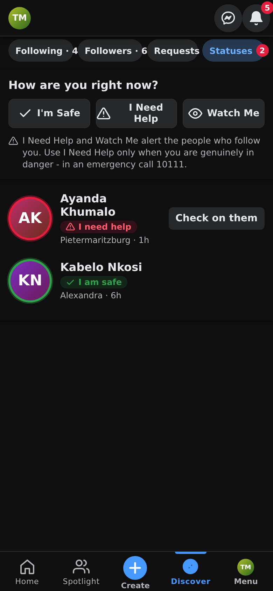

```text
Demo data - sample cases, not real people. Turn it off in the URL with ?demo=0
Discover
5
Following · 4
Followers · 6
Requests
Statuses
2
How are you right now?
I'm Safe
I Need Help
Watch Me
I Need Help and Watch Me alert the people who follow you. Use I Need Help only when you are genuinely in danger - in an emergency call 10111.
Ayanda Khumalo
I need help
Pietermaritzburg · 1h
Check on them
Kabelo Nkosi
I am safe
Alexandra · 6h
Home
Spotlight
Create
Discover
Menu
```

### 16b-discover-following


```text
Demo data - sample cases, not real people. Turn it off in the URL with ?demo=0
Discover
5
Following · 4
Followers · 6
Requests
Statuses
2
Lerato Mahlangu
@lerato.m · Friends · you follow each other
Unfollow
Kabelo Nkosi
@kabelo.n · Friends · you follow each other
Unfollow
Sipho Ndlela
@sipho.ndlela · Friends · you follow each other
Unfollow
Ayanda Khumalo
@ayanda.k · Friends · you follow each other
Unfollow
Home
Spotlight
Create
Discover
Menu
```

### 16c-discover-requests


```text
Demo data - sample cases, not real people. Turn it off in the URL with ?demo=0
Discover
5
Following · 4
Followers · 6
Requests
Statuses
2
No follow requests
When someone asks to follow you, you can confirm or delete it here.
Home
Spotlight
Create
Discover
Menu
```

### 18-notifications - /notifications

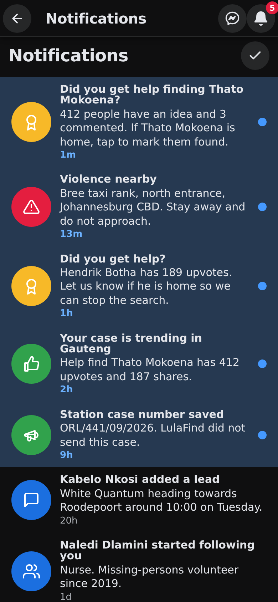

```text
Demo data - sample cases, not real people. Turn it off in the URL with ?demo=0
Notifications
5
Notifications
Did you get help finding Thato Mokoena?
412 people have an idea and 3 commented. If Thato Mokoena is home, tap to mark them found.
1m
Violence nearby
Bree taxi rank, north entrance, Johannesburg CBD. Stay away and do not approach.
13m
Did you get help?
Hendrik Botha has 189 upvotes. Let us know if he is home so we can stop the search.
1h
Your case is trending in Gauteng
Help find Thato Mokoena has 412 upvotes and 187 shares.
2h
Station case number saved
ORL/441/09/2026. LulaFind did not send this case.
9h
Kabelo Nkosi added a lead
White Quantum heading towards Roodepoort around 10:00 
```

### 19-found - /found

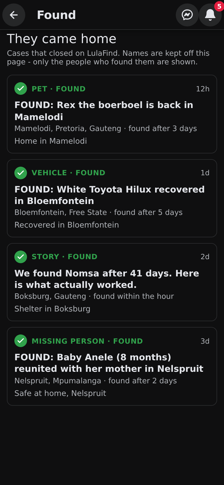

```text
Demo data - sample cases, not real people. Turn it off in the URL with ?demo=0
Found
5
They came home
Cases that closed on LulaFind. Names are kept off this page - only the people who found them are shown.
PET · FOUND
12h
FOUND: Rex the boerboel is back in Mamelodi
Mamelodi, Pretoria, Gauteng · found after 3 days
Home in Mamelodi
VEHICLE · FOUND
1d
FOUND: White Toyota Hilux recovered in Bloemfontein
Bloemfontein, Free State · found after 5 days
Recovered in Bloemfontein
STORY · FOUND
2d
We found Nomsa after 41 days. Here is what actually worked.
Boksburg, Gauteng · found within the hour
Shelter in Boksburg
MISSING PERSON · FOUND
3d
FOUND: Baby Anele (8 months) reunited with her mother in Nel
```

### 20-review-queue - /admin


```text
Demo data - sample cases, not real people. Turn it off in the URL with ?demo=0
Admin
5
You are signed in as an admin. You can remove posts, suspend people and delete accounts. Every action is recorded on the report.
Reports
People
Review
Posts
No open reports
Anything members report lands here.
```

### 21-settings - /settings

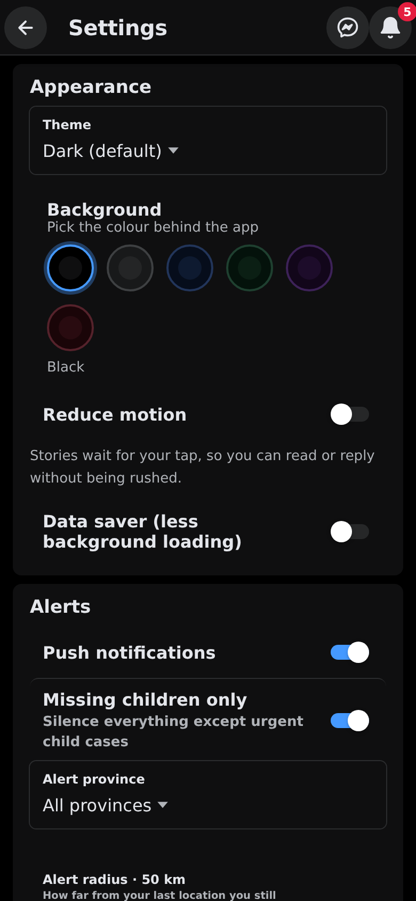

```text
Demo data - sample cases, not real people. Turn it off in the URL with ?demo=0
Settings
5
Appearance
Theme
Background
Pick the colour behind the app
Black
Reduce motion
Stories wait for your tap, so you can read or reply without being rushed.
Data saver (less background loading)
Alerts
Push notifications
Missing children only
Silence everything except urgent child cases
Alert province
Alert radius · 50 km
How far from your last location you still want case alerts
Privacy & data
Safety & consent centre
Terms, privacy and community rules
Admin - reports and moderation
FAQs
Who sees your profile is set in Me → Edit profile.
Let LulaFind post a case about me
Only after a follower says something 
```

### 22-faqs - /faqs

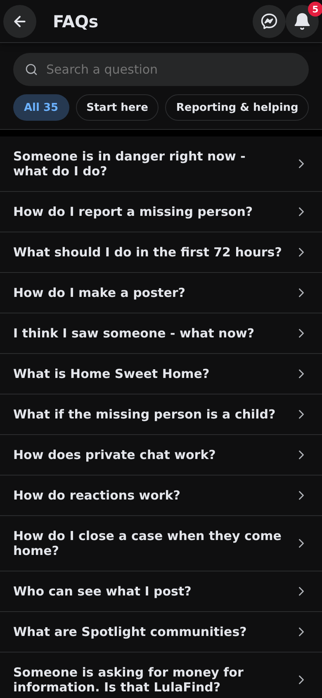

```text
Demo data - sample cases, not real people. Turn it off in the URL with ?demo=0
FAQs
5
All 35
Start here
Reporting & helping
Chat & follows
Stories & posting
Safety & privacy
Communities
Your account
Someone is in danger right now - what do I do?
How do I report a missing person?
What should I do in the first 72 hours?
How do I make a poster?
I think I saw someone - what now?
What is Home Sweet Home?
What if the missing person is a child?
How does private chat work?
How do reactions work?
How do I close a case when they come home?
Who can see what I post?
What are Spotlight communities?
Someone is asking for money for information. Is that LulaFind?
How long do stories last?
Which gender-based
```

### 23-help - /help

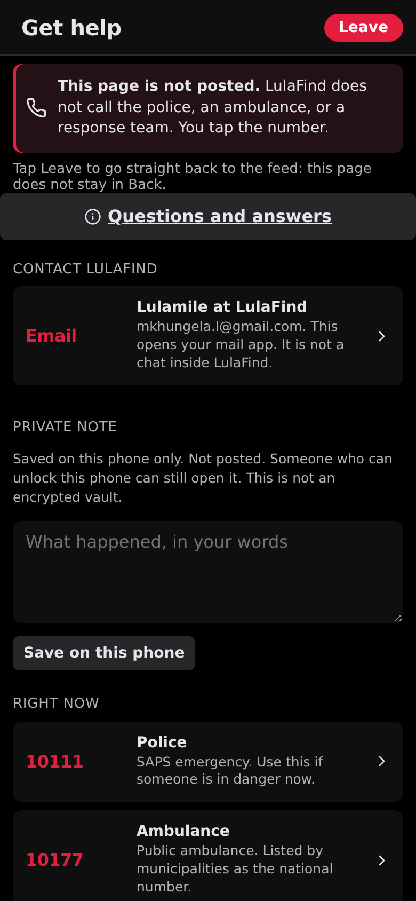

```text
Demo data - sample cases, not real people. Turn it off in the URL with ?demo=0
Get help
Leave
This page is not posted. LulaFind does not call the police, an ambulance, or a response team. You tap the number.
Tap Leave to go straight back to the feed: this page does not stay in Back.
Questions and answers
CONTACT LULAFIND
Email
Lulamile at LulaFind
mkhungela.l@gmail.com. This opens your mail app. It is not a chat inside LulaFind.
PRIVATE NOTE
Saved on this phone only. Not posted. Someone who can unlock this phone can still open it. This is not an encrypted vault.
Save on this phone
RIGHT NOW
10111
Police
SAPS emergency. Use this if someone is in danger now.
10177
Ambulance
Public ambulance. L
```

### 24-safety - /safety

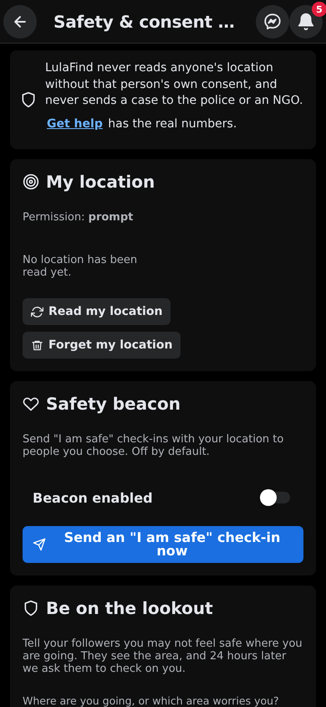

```text
Demo data - sample cases, not real people. Turn it off in the URL with ?demo=0
Safety & consent centre
5
LulaFind never reads anyone's location without that person's own consent, and never sends a case to the police or an NGO. Get help has the real numbers.
My location
Permission: prompt
No location has been read yet.
Read my location
Forget my location
Safety beacon
Send "I am safe" check-ins with your location to people you choose. Off by default.
Beacon enabled
Send an "I am safe" check-in now
Be on the lookout
Tell your followers you may not feel safe where you are going. They see the area, and 24 hours later we ask them to check on you.
Where are you going, or which area worries you?
An
```

### 25-search-soweto

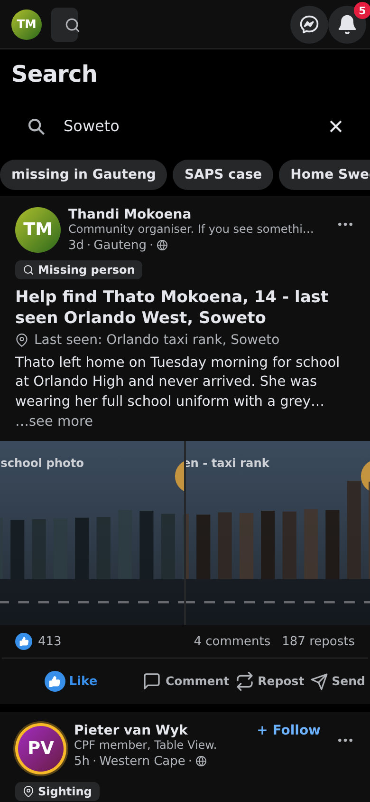

```text
Demo data - sample cases, not real people. Turn it off in the URL with ?demo=0
Search
5
Search
missing in Gauteng
SAPS case
Home Sweet Home
found
Orlando
Ndlela
Thandi Mokoena
Community organiser. If you see something, say something. Ubuntu.
3d
·
Gauteng
·
Missing person
Help find Thato Mokoena, 14 - last seen Orlando West, Soweto
Last seen: Orlando taxi rank, Soweto
Thato left home on Tuesday morning for school at Orlando High and never arrived. She was wearing her full school uniform with a grey cardigan and black takkies.
Her phone went off at 09:40 near the Orlando taxi rank. She was with her cousin Nokuthula, who says Thato said she was going to the clinic and would be back by 14:00. Sh
```

## Console errors

None.

## Clicks that did not change the screen text

- "Gauteng" on /onboarding left the screen text identical (may be a selection only)
- "Thato" on /home?demo=1 left the screen text identical (may be a selection only)
- "Ubuntu" on /post/p_thato/poster?demo=1 left the screen text identical (may be a selection only)

### Missing controls or screens

- the case page did not finish rendering
- no control "First hours" (checklist header) on /post/p_thato?demo=1
- no control "Open a case at any police station" to tap (a checklist step)
- ticking a checklist step changed nothing
- no field input.heading-input (heading) on /new?demo=1
- the heading field did not keep what was typed